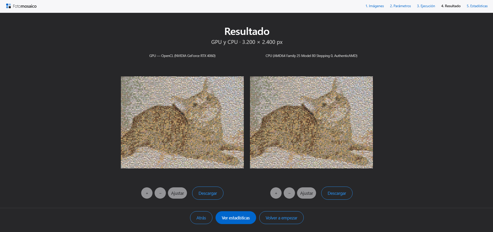
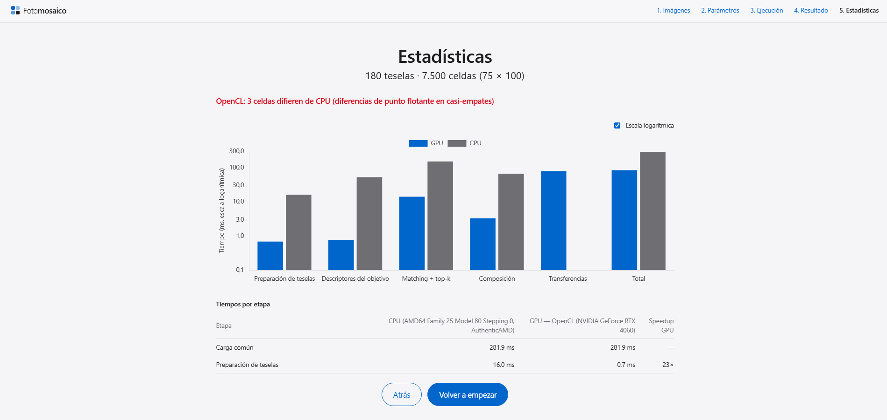

# Manual de usuario — Fotomosaico CPU / CUDA / OpenCL

Guía paso a paso para instalar, levantar y usar la aplicación, con capturas reales de una corrida completa.

## 1. Instalación y arranque

Desde una terminal (PowerShell en Windows), parado en la carpeta `TP-Integrador`, ejecutar:

```
.\start.ps1
```

(en Linux/macOS: `./start.sh`). El script instala dependencias si hace falta, levanta el backend (FastAPI) y el frontend (Vite), y muestra la URL local para abrir en el navegador, normalmente `http://127.0.0.1:5173`.


> Si aparece un aviso de que CUDA no está disponible, no es un error: solo significa que esa máquina no tiene una GPU NVIDIA, y la aplicación sigue funcionando con CPU y/o OpenCL.

## 2. Paso 1 — Imágenes

Al abrir la URL se accede al asistente paso a paso. Lo primero es subir dos cosas: el **lote de teselas** (las fotos chiquitas que van a formar el mosaico) y la **imagen objetivo** (la foto grande que se quiere reconstruir).


Este proyecto incluye un lote de prueba listo para usar en `muestras/lote_teselas_perros_gatos/` (180 fotos reales de perros y gatos) junto con dos imágenes objetivo de ejemplo — ver la sección 6.

## 3. Paso 2 — Parámetros

Acá se configuran tres valores:

- **Columnas**: cuántas celdas de ancho tiene la grilla del mosaico. Más columnas = mosaico más fiel al original, pero más cálculo.
- **Píxeles por tesela**: la resolución final de cada tesela dentro del mosaico armado.
- **Semilla**: número fijo que decide cuál de las mejores teselas candidatas se usa en cada celda. Con la misma semilla, el resultado es siempre el mismo mosaico, sea cual sea el backend.

El recuadro inferior se recalcula solo: cantidad de celdas totales y de comparaciones de color que va a hacer el algoritmo.


## 4. Paso 3 — Ejecución

Se elige qué backend correr: **CPU**, **GPU** (CUDA u OpenCL, según lo que detecte la máquina) o **Ambas**, para correr los dos sobre el mismo trabajo y poder comparar resultados y tiempos.


## 5. Paso 4 — Resultado

Se muestra el mosaico armado. Si se corrió "Ambas", se ven los dos mosaicos (CPU y GPU) lado a lado, con zoom y pan sincronizados entre los dos visores, para comparar a simple vista.



Al acercar el zoom se distingue que cada celda es una foto real del lote de teselas, no un promedio de color.


El mosaico se puede descargar en PNG o JPEG desde esta misma pantalla.

## 6. Paso 5 — Estadísticas

La última pantalla es la más importante para evaluar el trabajo: muestra los tiempos reales medidos por etapa, el speedup de GPU contra CPU, y una verificación automática que compara, celda por celda, si los dos backends eligieron la misma tesela.



Las tres lecturas más importantes de esta pantalla:

1. **Carga común**: tiempo de cargar y decodificar las teselas de disco. Es igual para los dos backends y no cuenta como parte del speedup.
2. **Preparación de teselas**: la etapa que realmente se paraleliza — acá es donde se ve la diferencia grande entre CPU y GPU.
3. **Verificación**: cuántas celdas (de las miles generadas) eligieron una tesela distinta entre CPU y GPU. Un número bajo (normalmente menos del 0,1%) es esperable, por diferencias de redondeo de punto flotante entre las dos implementaciones, no un error.

## 7. Lote de pruebas incluido

Para no depender de conseguir fotos propias, el repositorio incluye en `muestras/lote_teselas_perros_gatos/` un lote de 180 fotos reales de perros y gatos (90 de cada uno) listo para usar como lote de teselas, junto con dos imágenes objetivo de ejemplo (`imagen_objetivo_perro.jpg` e `imagen_objetivo_gato.jpg`) para probar la aplicación de punta a punta sin pasos previos.
