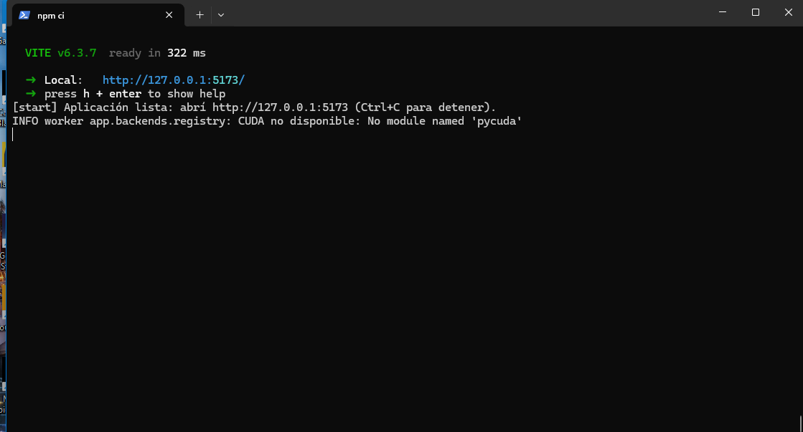
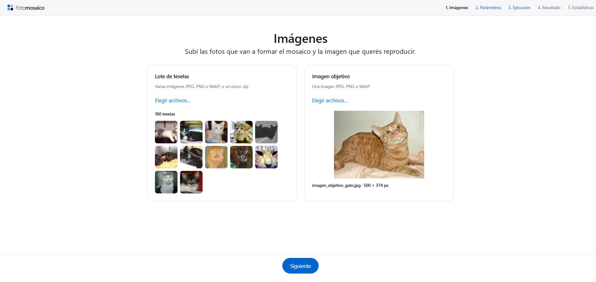
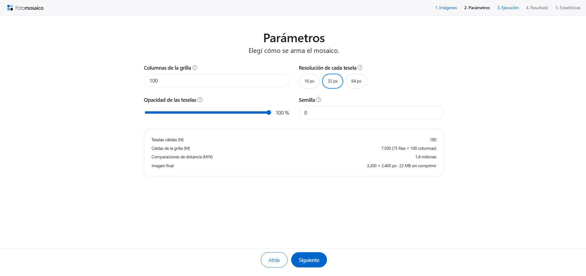
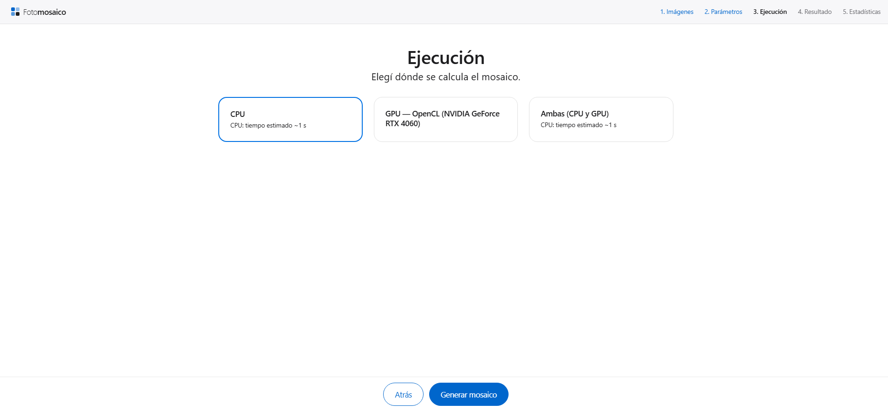
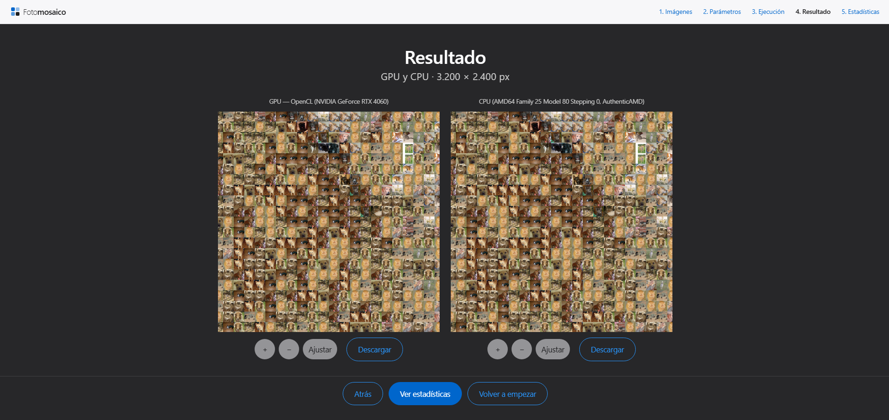

# Manual de usuario — Fotomosaico CPU / CUDA / OpenCL

Guía paso a paso para instalar, levantar y usar la aplicación, con capturas reales de una corrida completa.

## 1. ¿Qué es Fotomosaico?

Fotomosaico arma, a partir de un lote de fotos (teselas) y una imagen objetivo, una versión del objetivo reconstruida con esas teselas. Donde el algoritmo compite de verdad es en el tiempo: el mismo trabajo se puede correr en la CPU de tu máquina o, si tenés una placa de video compatible, acelerarlo con GPU.

Como usuario solo tenés que hacer tres cosas:

1. Subir el lote de teselas y la imagen objetivo.
2. Elegir los parámetros de la grilla (columnas, resolución de tesela, opacidad, semilla).
3. Elegir dónde correr el trabajo (CPU, GPU o ambas) y presionar **Generar mosaico**.

El sistema detecta solo el mejor motor de procesamiento disponible (GPU NVIDIA/CUDA → GPU AMD-Intel/OpenCL → CPU). No necesitás configurar nada de hardware: funciona en cualquier máquina, con o sin placa de video.

## 2. Antes de empezar (requisitos)

Para el uso normal (CPU o GPU si la tenés) solo necesitás:

- Python 3.11 o superior (probado con 3.13).
- Node.js 20.19 o superior — los scripts de arranque lo instalan solos si no está.
- Un navegador moderno (Chrome, Edge o Firefox recientes).
- Opcional: drivers NVIDIA + CUDA Toolkit, o drivers OpenCL (AMD/Intel), para acelerar por GPU.

> **La GPU es opcional.** Si tu equipo no tiene placa de video compatible, el sistema usa automáticamente la CPU. La aceleración por GPU no es obligatoria para usar la aplicación.

## 3. Instalación

Abrí una terminal en la carpeta `TP-Integrador/` y ejecutá el script de arranque:

```bash
./start.sh                # macOS / Linux
```

```powershell
.\start.ps1              # Windows (PowerShell)
```

La primera vez instala todo lo que falta (puede tardar unos minutos y necesita conexión a internet); las siguientes veces arranca directo. Al terminar, imprime la URL de la aplicación (por defecto `http://127.0.0.1:5173`) y la deja abierta en la terminal:



_Frontend (Vite) y backend corriendo juntos tras `./start.sh` — el aviso "CUDA no disponible" es normal en una máquina sin GPU NVIDIA: la aplicación sigue funcionando con el siguiente backend disponible._

**Ctrl+C** en esa misma terminal apaga los dos procesos de forma ordenada, sin dejar nada corriendo en segundo plano.

## 4. Recorrido por la interfaz (5 pasos)

La aplicación es una sola pantalla con un stepper de cinco pasos arriba (Imágenes, Parámetros, Ejecución, Resultado, Estadísticas). Cada paso tiene "Atrás" y una acción para avanzar; se puede volver a cualquier paso ya alcanzado.

### Paso 1 — Imágenes

Se sube el lote de teselas (varias imágenes JPEG/PNG/WebP, o un único `.zip`) y la imagen objetivo. Cada archivo se sube apenas se elige, con barra de progreso, y se ve un resumen con miniaturas.



_Paso 1 — lote de 180 teselas (fotos de perros y gatos) + imagen objetivo._

### Paso 2 — Parámetros

Se eligen las columnas de la grilla, la resolución de cada tesela (16, 32 o 64 px), la opacidad de las teselas y la semilla. Debajo se recalcula en vivo cuántas teselas válidas hay (N), cuántas celdas (M) y el tamaño de la imagen final.



_Paso 2 — 100 columnas, teselas de 32 px → 7.500 celdas (75×100), 1,4 millones de comparaciones._

### Paso 3 — Ejecución

Se elige dónde correr el trabajo: CPU, GPU (la API la decide el sistema según el hardware detectado) o Ambas (ver sección 5). Sin GPU, esas opciones aparecen deshabilitadas con el motivo.



_Paso 3 — esta máquina detectó GPU OpenCL (NVIDIA GeForce RTX 4060); con CPU, antes de generar se muestra el tiempo estimado._

### Paso 4 — Resultado

Se ve el mosaico generado, con zoom (rueda o botones) y descarga en PNG o JPEG. Si se corrió en modo "Ambas", se ven los dos mosaicos lado a lado, cada uno con su backend y dispositivo:



_Paso 4 — resultado en modo "Ambas": GPU (OpenCL) y CPU sobre la misma imagen objetivo, 3.200 × 2.400 px._

### Paso 5 — Estadísticas

La tabla de tiempos por etapa. En modo "Ambas" se agrega la comparativa descripta en la sección 5 (gráfico y speedup por etapa):


_Paso 5 — 180 teselas, 7.500 celdas; "preparación de teselas" pasa de 16,0 ms (CPU) a 0,7 ms (GPU): ahí está el ×23 de esta corrida._

## 5. Modo comparación — "Ambas" (CPU y GPU)

La opción **"Ambas (CPU y GPU)"** del paso 3 ejecuta el mismo trabajo en la GPU y en la CPU, con condiciones idénticas: la carga se hace una sola vez y los dos backends reciben los mismos datos, los mismos parámetros y la misma tabla de elección de tesela por celda. Corren de a uno, nunca en simultáneo.

- **Resultado:** los dos mosaicos lado a lado, cada uno con su descarga y su zoom — el zoom es compartido: acercar una zona de uno muestra la misma zona del otro.
- **Gráfico:** barras agrupadas (GPU y CPU) por etapa. Como la GPU puede ser cientos de veces más rápida, el eje pasa a escala logarítmica automáticamente cuando la diferencia lo justifica, para que la distancia entre barras se lea como "cuántas veces más rápido".
- **Speedup:** una columna por etapa con tiempo CPU / tiempo GPU. El speedup del total incluye las transferencias entre CPU y GPU, por eso suele ser menor que el de la etapa de matching sola: es la ganancia real para quien usa la GPU.
- **Si la GPU falla** (por ejemplo, por memoria), la CPU se ejecuta igual y se avisa "GPU falló: &lt;motivo&gt;", mostrando solo el resultado de CPU.

Comparar CUDA contra OpenCL sobre la misma placa no se hace desde esta interfaz, sino con el benchmark sin interfaz (sección 6), que mide ambas APIs por separado.

## 6. Benchmark sin interfaz

Además de la interfaz, el proyecto incluye un programa de consola, `backend/benchmark.py`, que ejecuta el mosaico varias veces con tamaños crecientes y mide **cómo escala** cada backend a medida que el problema crece. A diferencia de la interfaz, mide CUDA y OpenCL por separado. Desde la carpeta `backend/`:

```bash
../.venv/bin/python benchmark.py          # Linux / macOS
```

```powershell
..\.venv\Scripts\python.exe benchmark.py   # Windows
```

Al terminar genera una tabla con los tiempos y el speedup de cada combinación, un archivo CSV y un gráfico, en la carpeta `backend/resultados/`.

## 7. Interpretar los resultados

Resultados en la máquina de desarrollo (RTX 2080 SUPER y un Ryzen), en milisegundos:

| Tamaño del problema                    | Comparaciones |   CPU [ms] | GPU CUDA [ms] | Speedup |
| -------------------------------------- | ------------: | ---------: | ------------: | ------: |
| Chico (100 teselas, 1.000 celdas)      |       100 mil |       20,8 |           1,9 |     11× |
| Mediano (1.000 teselas, 40.000 celdas) |   40 millones |    3.159,0 |          60,5 |     52× |
| Grande (5.000 teselas, 40.000 celdas)  |  200 millones |   14.168,7 |         128,6 | **110×** |

- **Speedup:** cuántas veces más rápida fue la GPU que la CPU. Por ejemplo, 110× significa que lo que a la CPU le llevó 14 segundos, la GPU lo hizo en poco más de una décima de segundo.
- **Cuanto más grande el problema, más gana la GPU:** la GPU tiene un costo fijo (copiar los datos a la placa y lanzar el trabajo) que en problemas chicos pesa mucho y en problemas grandes se vuelve insignificante.
- **Con problemas diminutos la GPU no conviene:** con 10 teselas y 12 celdas la CPU y la GPU tardan prácticamente lo mismo (medio milisegundo). Cualquier mosaico real ya es mucho más grande que eso.

## 8. Preguntas frecuentes y solución de problemas

**El sistema dice "CPU" y yo esperaba GPU.**
No se detectó una placa compatible o faltan los drivers. Con NVIDIA hacen falta los drivers + CUDA Toolkit; con AMD/Intel, drivers OpenCL. Igual funciona todo en CPU.

**Quiero forzar CPU aunque tenga GPU.**
Se puede correr con la opción `--cpu-only` del script de arranque, que no instala ninguna biblioteca de GPU.

**Las opciones "GPU" y "Ambas" están deshabilitadas.**
El sistema no detectó ninguna placa compatible; el motivo se muestra junto a la opción deshabilitada.

**Quiero comparar CUDA contra OpenCL en la misma placa NVIDIA.**
Eso no se hace desde la interfaz (que solo compara GPU contra CPU), sino con el benchmark (sección 6), exportando `OPENCL_DEVICE=NVIDIA` antes de correrlo.

**El puerto 5173 o 8000 ya está en uso.**
Cerrá cualquier otra instancia de la aplicación (Ctrl+C en su terminal) antes de levantar una nueva.

**Quiero reinstalar las dependencias desde cero.**
Corré el script de arranque con `--reinstall`.
